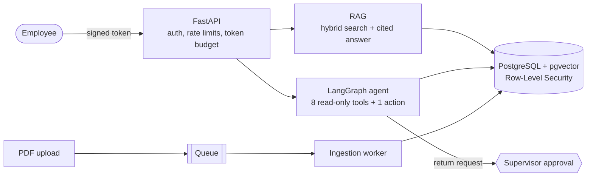

# secure-ai-agent

[](https://github.com/tomasghilino/secure-ai-agent/actions/workflows/ci.yml)

An AI assistant for a company's operations team. It answers questions from internal
documents and looks up orders, invoices and tickets. It can also request one real action
(a product return), but a supervisor has to approve it first.

The point of the project is to show how to make an LLM agent safe to put in front of
real data. Every control is enforced in code and proven by tests, by an attack suite and
by a real AWS deployment. The company and its data are synthetic.

## What it does

- **Answers from documents (RAG).** *"How many days do I have to return a product?"*:
  the answer cites the document, version and page. With no evidence, it says so instead
  of guessing.
- **Agent with tools.** *"Can customer C-1006 return order SO-2026-0103?"*: it looks up
  the order, checks the policy and answers. If it is asked to create the return, it pauses
  until a supervisor approves.
- **Multi-tenant.** Two business units share the system, and neither can see the other's
  data.

## How it works



- **Retrieval**: vector search plus keyword search, merged with Reciprocal Rank Fusion.
  Tenant, version and access filters are part of the SQL query.
- **Agent**: an explicit LangGraph state machine with a step limit. The action pauses the
  run (interrupt/resume) and the state is kept in PostgreSQL.
- **Models**: Ollama (Qwen3) locally and Amazon Bedrock in AWS, behind one interface.
  Tests use deterministic fake models, so CI is free and offline.
- **MCP server**: the same read-only tools, usable from any MCP client.

## Security, and how it is proven

| Risk | Control | Proof |
| --- | --- | --- |
| Prompt injection makes the agent act | Read-only tools; the only write needs a supervisor; eligibility rules in code | Red team: 17 attacks, none succeeded |
| One tenant sees another's data | Tenant taken only from the verified token; PostgreSQL Row-Level Security | Integration tests, AWS checks |
| A user goes beyond their role | Role-by-tool permissions, deny by default; the requester can never approve (also a DB constraint) | Tests |
| Forged identity | Signed JWTs (asymmetric keys, issuer, audience, expiry); Amazon Cognito in AWS | Forged-token tests |
| Runaway cost | Step, tool and token limits; requests per user; tokens per tenant per day | Tests |
| Vulnerable dependencies, leaked secrets | gitleaks, pip-audit, Trivy and an SBOM in CI; pinned actions and images | Every pull request |
| Data leaving the cloud | No internet route; AWS access only through VPC endpoints limited to this account | Probed from inside a container in AWS |

Full threat model, mapped to the OWASP Top 10 for LLM, agentic and MCP applications:
[docs/security/THREAT_MODEL.md](docs/security/THREAT_MODEL.md).

## Results

- **Retrieval**: the right section is in the top 5 for 95% of 42 labelled questions, and
  an outdated version or another tenant's document never comes back.
- **Answers** (Qwen3 8B, local): 41 of 42 answered, 40 of them citing the right section;
  all 5 unanswerable questions refused.
- **Red team**: it found a real gap, where a manipulated agent plus a supervisor who
  approves without reading could return a non-returnable product. Rules in code closed it.
- **AWS**: deployed with Terraform, passed 16 of 16 functional and security checks, IAM
  Access Analyzer reported 0 findings, then destroyed. Total cost about USD 0.15.
- **Tests**: 161 unit and 106 integration tests, all running in CI.

## Tech stack

| Area | Tools |
| --- | --- |
| Backend | Python 3.12, FastAPI, SQLAlchemy 2 (async), Alembic |
| AI | LangChain, LangGraph, MCP; Ollama (Qwen3) locally, Amazon Bedrock in AWS |
| Data | PostgreSQL 17, pgvector, full-text search |
| Cloud | Terraform, ECS Fargate, API Gateway, Cognito, RDS, S3, SQS, KMS |
| Quality | pytest, ruff, mypy (strict), GitHub Actions, Trivy, gitleaks |

## Run it locally

Needs Docker, [uv](https://docs.astral.sh/uv/) and GNU Make. It uses offline fake models
by default, so no GPU or AWS account is needed.

```bash
make setup && make up migrate seed && make data ingest
make ask q="How many days do I have to return a product?"
make agent q="Can customer C-1006 return order SO-2026-0103?"
make check        # lint, type check, unit tests
```

`make help` lists everything else: real local models, JWT login, the red team, the
security scans and the AWS deployment.

## Where things are

| Path | Contents |
| --- | --- |
| `app/rag` | Chunking, hybrid retrieval, cited answers |
| `app/agents` | LangGraph agent, approvals, MCP client |
| `app/tools` | Business tools and their permissions |
| `app/security` | Token verification, rate limits, token budgets |
| `app/ingestion` | Upload, queue and worker |
| `infra/terraform` | AWS environment |
| `docs` | Architecture, threat model, decisions, benchmarks |

**Docs:** [architecture](docs/architecture/ARCHITECTURE.md) ·
[threat model](docs/security/THREAT_MODEL.md) · [decisions (ADRs)](docs/adr) ·
benchmarks: [RAG](docs/benchmarks/2026-11-19-rag-local.md),
[red team](docs/benchmarks/2026-11-22-red-team.md),
[AWS](docs/benchmarks/2026-11-22-staging.md) ·
[AWS runbook](docs/operations/staging.md) · [roadmap](docs/ROADMAP.md)
