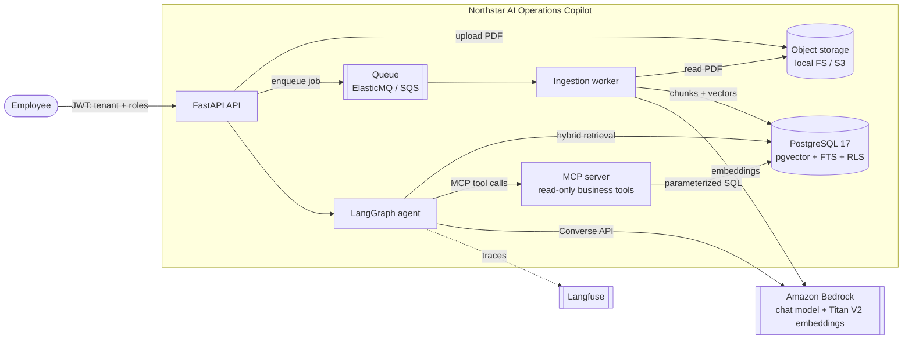
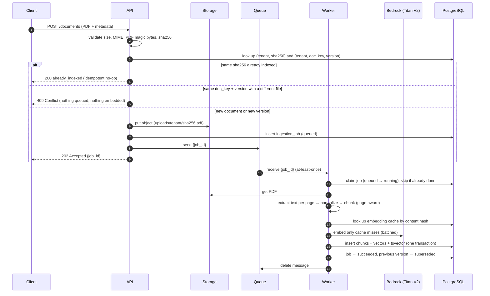
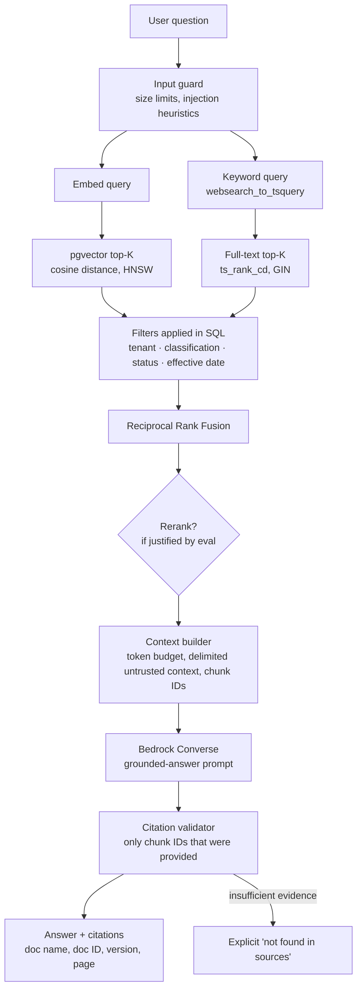
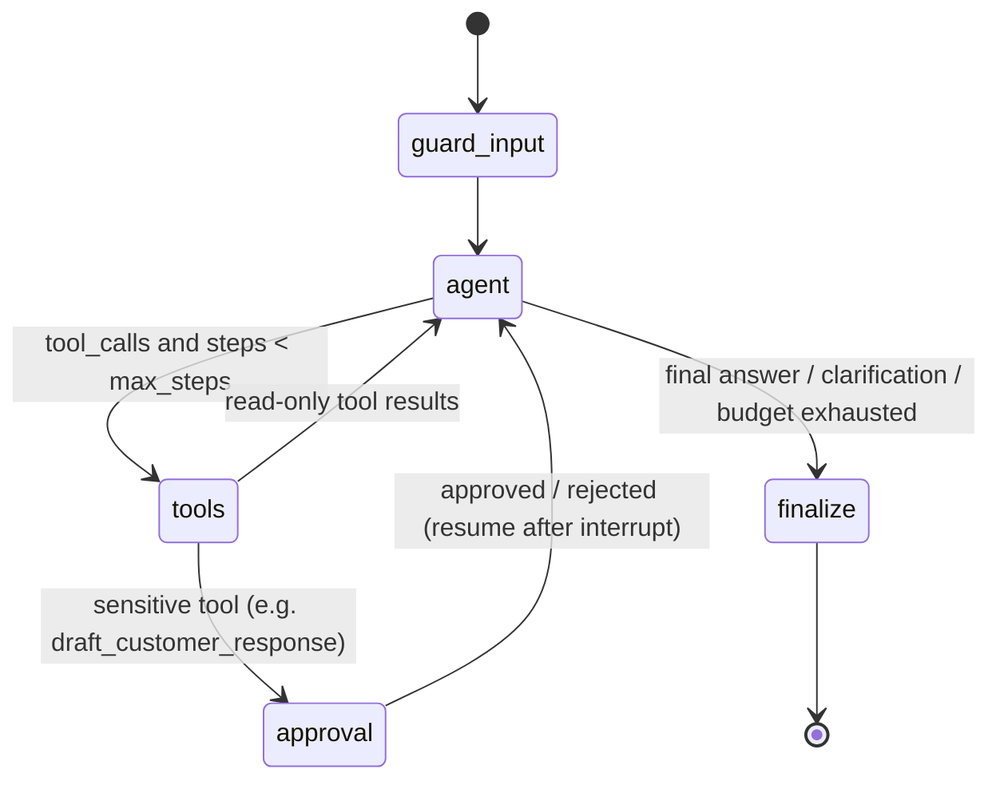
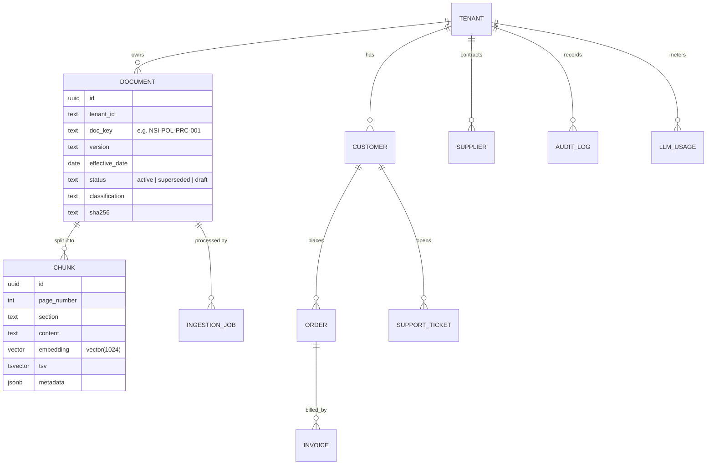

# Architecture — Northstar AI Operations Copilot

> Status: **proposed** (Day 0). Sections are refined as each milestone lands.
> Significant decisions are recorded as ADRs in [`docs/adr`](../adr).

## 1. Problem and scope

Northstar Industrial (fictional) is an industrial equipment distributor with two legal
entities. Employees need one assistant that can:

1. Answer questions **grounded** in company documents (policies, contracts, catalogs),
   with verifiable citations (document, version, page).
2. Query **structured business data** (orders, invoices, tickets, suppliers) through
   safe, predefined tools — never free-form SQL.
3. Prepare **controlled workflows** (e.g. a customer response draft) that require a
   human approval before anything "sensitive" happens.

Non-goals: connecting to real external systems, building a UI beyond a minimal demo,
fine-tuning models.

## 2. System context

**Tenancy model.** Two tenants: `nsi-amer` (Northstar Industrial Americas) and
`nsi-emea` (Northstar Industrial EMEA). Every row of tenant data carries a `tenant_id`.
Isolation is enforced twice: in application queries **and** with PostgreSQL
Row-Level Security (defense in depth). The tenant always comes from the verified token,
never from model output or request bodies.

## 3. Ingestion pipeline (Day 1)

Key properties:

- **Asynchronous**: the API never parses or embeds inline; a slow or failing model call
  cannot block uploads.
- **Idempotent**: `(tenant_id, sha256)` deduplicates uploads; the worker re-checks job
  state because SQS delivers *at least once*; chunk writes are transactional.
- **Cost-aware**: embeddings are cached by `(content_hash, model_id, dimensions)`, so
  re-indexing unchanged text is free.
- **Failure handling**: visibility timeout + max receive count → dead-letter queue.

## 4. Query path — RAG (Day 2)

Every stage is a separate, testable component (`app/rag/*`). Retrieval is evaluated
**independently** of generation (recall@k / precision@k / MRR on a labelled dataset).

## 5. Agent orchestration (Day 3)

- **Explicit state** (`messages`, `tenant`, `roles`, `step_count`, `tool_calls_made`,
  `citations`, `pending_action`, `usage`).
- **Bounded loop**: `max_steps`, `max_tool_calls`, LangGraph `recursion_limit`,
  per-request token budget.
- **Tool authorization** happens in code before execution (role × tool matrix), not in
  the prompt.
- **Human-in-the-loop**: LangGraph `interrupt()` + PostgreSQL checkpointer; the API
  exposes approve/reject endpoints that resume the thread.
- **MCP**: read-only business tools live in a separate MCP server process and are
  discovered at runtime through `langchain-mcp-adapters`.

## 6. Data model (preliminary)

## 7. Security architecture (summary)

| Threat | Control |
| --- | --- |
| Cross-tenant data leak | Tenant from verified JWT only; tenant filter in every query; PostgreSQL RLS |
| Unauthorized document access | Classification × role check applied inside the retrieval SQL |
| Prompt injection via documents | Retrieved text wrapped as delimited *untrusted data*; system prompt states it is never instructions; tools authorized in code |
| LLM-driven SQL abuse | No text-to-SQL; only parameterized, predefined, read-only queries; read-only DB role for tools |
| Sensitive actions | Approval interrupt; actions only *drafted*, never sent externally |
| Malicious uploads | Size limit, MIME + `%PDF-` magic bytes, page limit, PyMuPDF parse in worker |
| Secret leakage | No secrets in code/env files; AWS via SSO profile locally, IAM task role in AWS; log redaction |
| Cost abuse | Max output tokens, max agent steps, per-tenant daily token budget, rate limits |
| Lack of traceability | Audit log for tool calls and approvals; Langfuse traces |

## 8. Local vs AWS staging

| Concern | Local (Docker Compose) | AWS staging (ephemeral) |
| --- | --- | --- |
| API / worker / MCP | Containers with hot reload | ECS Fargate tasks (images in ECR) |
| Database | `pgvector/pgvector:0.8.7-pg17` | RDS PostgreSQL 17 `db.t4g.micro`, single-AZ |
| Object storage | Local filesystem adapter | S3 (private, SSE-S3) |
| Queue | ElasticMQ (SQS-compatible API) | SQS + DLQ |
| LLM / embeddings | `fake` providers or Bedrock via SSO profile | Bedrock via IAM task role |
| Secrets | `.env` (no AWS keys) | Secrets Manager |
| Logs / traces | stdout (structlog) + optional Langfuse | CloudWatch Logs + optional Langfuse |

AWS constraints: no NAT Gateway (public subnets + security groups), no OpenSearch,
no Bedrock Knowledge Bases, no Provisioned Throughput, everything tagged and destroyed
after the demo. Infrastructure is described in Terraform with local state.
