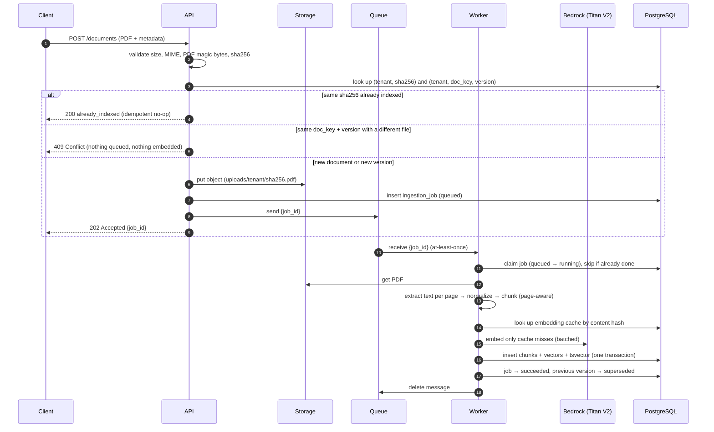
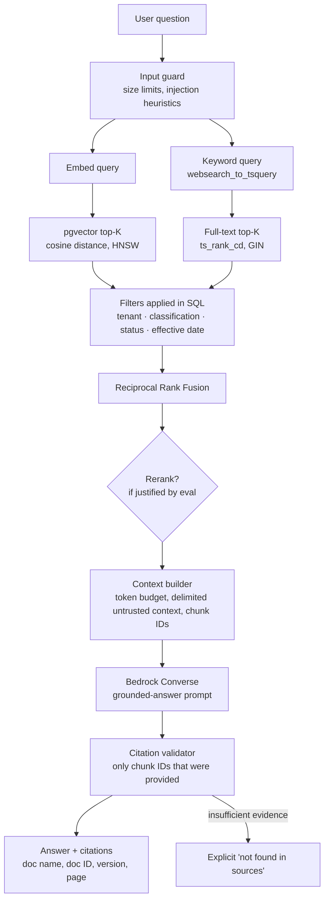
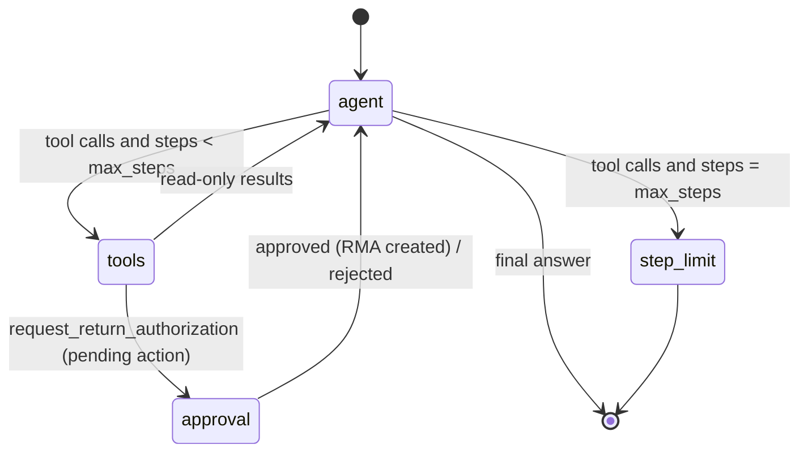
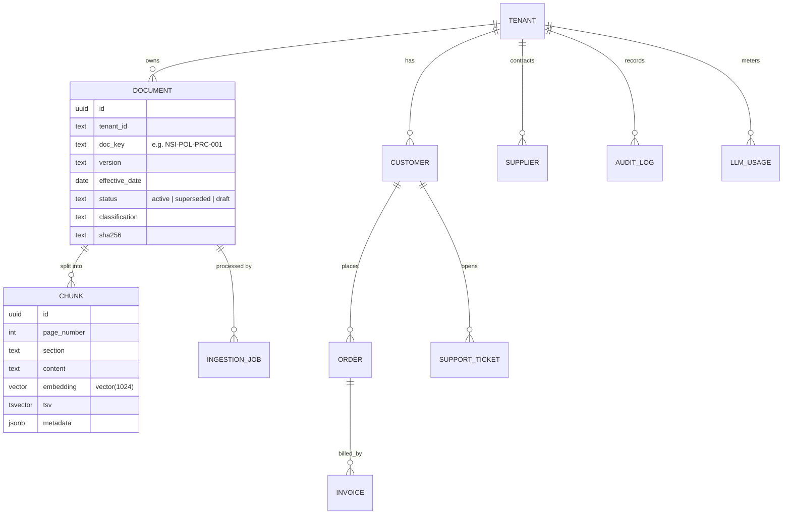

# Architecture — Northstar AI Operations Copilot

> Sections are refined as each milestone lands.
> Significant decisions are recorded as ADRs in [`docs/adr`](../adr).

## 1. Problem and scope

Northstar Industrial (fictional) is an industrial equipment distributor with two legal
entities. Employees need one assistant that can:

1. Answer questions **grounded** in company documents (policies, contracts, catalogs),
   with verifiable citations (document, version, page).
2. Query **structured business data** (orders, invoices, tickets, suppliers) through
   safe, predefined tools — never free-form SQL.
3. Prepare **controlled workflows** (e.g. a customer response draft) that require a
   human approval before anything "sensitive" happens.

Non-goals: connecting to real external systems, building a UI beyond a minimal demo,
fine-tuning models.

## 2. System context

**Tenancy model.** Two tenants: `nsi-amer` (Northstar Industrial Americas) and
`nsi-emea` (Northstar Industrial EMEA). Every row of tenant data carries a `tenant_id`.
Isolation is enforced twice: in application queries **and** with PostgreSQL
Row-Level Security (defense in depth). The tenant always comes from the verified token,
never from model output or request bodies.

## 3. Ingestion pipeline

Key properties:

- **Asynchronous**: the API never parses or embeds inline; a slow or failing model call
  cannot block uploads.
- **Idempotent**: `(tenant_id, sha256)` deduplicates uploads; the worker re-checks job
  state because SQS delivers *at least once*; chunk writes are transactional.
- **Cost-aware**: embeddings are cached by `(content_hash, model_id, dimensions)`, so
  re-indexing unchanged text is free.
- **Failure handling**: visibility timeout + max receive count → dead-letter queue.

## 4. Query path — RAG

Every stage is a separate, testable component (`app/rag/*`). Retrieval is evaluated
**independently** of generation (recall@k / precision@k / MRR on a labelled dataset).

## 5. Agent orchestration

- **State**: `messages`, `steps`, `pending_action`, `stop_reason`, saved after every step
  by the PostgreSQL checkpointer (schema `agent_checkpoints`) under the thread id.
- **Identity**: the requester's tenant, user and role come from the request and live
  outside the state; the run resumes as the requester after approval.
- **Bounded loop**: `AGENT_MAX_STEPS`, `AGENT_MAX_TOOL_CALLS_PER_STEP`,
  `AGENT_TOOL_RESULT_MAX_CHARS`, LangGraph `recursion_limit`.
- **Tool authorization** in code (role × tool, deny by default), re-checked on every call;
  RLS underneath. Every call and decision lands in the append-only `audit_events`.
- **Human-in-the-loop**: `interrupt()` in the approval node; `POST
  /v1/agent/threads/{id}/decision` (supervisor, not the requester) resumes it.
- **MCP**: the same read-only tools behind an MCP server over stdio (`python -m
  app.mcp_server`); with `AGENT_TOOL_TRANSPORT=mcp` the agent starts it as a subprocess
  and accepts only tools whose hash matches the reviewed catalog (ADR-0008).

## 6. Data model (preliminary)

## 7. Security architecture (summary)

| Threat | Control |
| --- | --- |
| Forged identity | JWT verified against the provider's JWKS (asymmetric algorithms, issuer, audience, expiry); one role from claims |
| Cross-tenant data leak | Tenant from verified JWT only; tenant filter in every query; PostgreSQL RLS |
| Unauthorized document access | Classification × role check applied inside the retrieval SQL |
| Prompt injection via documents | Retrieved text wrapped as delimited *untrusted data*; system prompt states it is never instructions; tools authorized in code |
| LLM-driven SQL abuse | No text-to-SQL; only parameterized, predefined, read-only queries; read-only DB role for tools |
| Sensitive actions | Approval interrupt; actions only *drafted*, never sent externally |
| Malicious uploads | Size limit, MIME + `%PDF-` magic bytes, page limit, PyMuPDF parse in worker |
| Secret leakage | No secrets in code/env files; AWS via SSO profile locally, IAM task role in AWS; log redaction |
| Cost abuse | Max output tokens, max agent steps, per-tenant daily token budget, rate limits |
| Lack of traceability | Audit log for tool calls and approvals; Langfuse traces |
| Supply chain | CI: gitleaks, pip-audit, Trivy, SBOM; actions pinned by SHA, images by digest; hardened non-root runtime image |

Full threat model, test evidence and residual risks: [THREAT_MODEL.md](../security/THREAT_MODEL.md).

## 8. Local vs AWS staging

| Concern | Local (Docker Compose) | AWS staging (ephemeral) |
| --- | --- | --- |
| API / worker / MCP | Containers with hot reload | ECS Fargate tasks (images in ECR) |
| Database | `pgvector/pgvector:0.8.7-pg17` | RDS PostgreSQL 17 `db.t4g.micro`, single-AZ |
| Object storage | Local filesystem adapter | S3 (private, SSE-S3) |
| Queue | ElasticMQ (SQS-compatible API) | SQS + DLQ |
| LLM / embeddings | `fake` providers or Bedrock via SSO profile | Bedrock via IAM task role |
| Secrets | `.env` (no AWS keys) | Secrets Manager |
| Logs / traces | stdout (structlog) + optional Langfuse | CloudWatch Logs + optional Langfuse |

AWS constraints: no NAT Gateway (public subnets + security groups), no OpenSearch,
no Bedrock Knowledge Bases, no Provisioned Throughput, everything tagged and destroyed
after the demo. Infrastructure is described in Terraform with local state.
