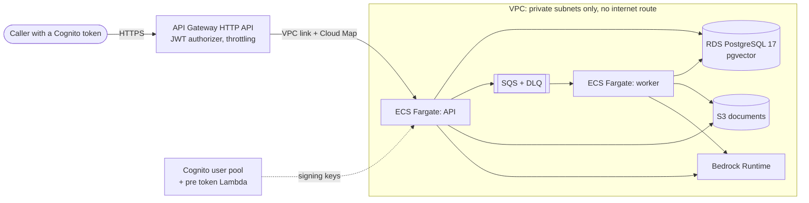

# AWS staging: deploy, verify, destroy

The environment is disposable: create it for a demo, destroy it the same day. Design and
trade-offs: [ADR-0011](../adr/0011-private-staging-on-aws.md).



## Cost

Estimated from public us-east-1 list prices; confirm in the plan and the AWS Pricing
Calculator before applying.

| Resource | Rate | Per hour |
| --- | --- | --- |
| 6–7 interface VPC endpoints, one AZ (Bedrock's only with Bedrock providers) | USD 0.01 per endpoint-hour | 0.060–0.070 |
| Fargate API task (0.5 vCPU, 1 GB) | 0.04048 per vCPU-hour + 0.004445 per GB-hour | 0.025 |
| Fargate worker task (0.25 vCPU, 1 GB) | same | 0.015 |
| RDS `db.t4g.micro`, single-AZ, 20 GB gp3 | 0.016 per hour + storage | 0.019 |
| KMS key, database secret, registry storage | monthly fees, prorated | 0.002 |
| API Gateway, SQS, S3, Lambda, logs, Cognito (Essentials free tier) | per request / GB | ~0 at demo volume |
| **Total, idle** | | **~0.12–0.13** |

Bedrock tokens come on top (ADR-0004: about USD 0.75 for a generous evaluation). A Cloud
Map namespace creates a Route 53 private hosted zone, free if deleted within 12 hours.

## Before the first deployment

1. Sign in: `aws sso login --profile <profile>` and `export AWS_PROFILE=<profile>`.
2. Check Bedrock access and quotas (a few tokens, fractions of a cent):

   ```bash
   aws bedrock-runtime converse --model-id us.anthropic.claude-haiku-5-5 \
     --messages '[{"role":"user","content":[{"text":"Reply with OK"}]}]'
   aws bedrock-runtime invoke-model --model-id amazon.titan-embed-text-v2:0 \
     --body '{"inputText":"ping"}' --cli-binary-format raw-in-base64-out /dev/stdout
   ```

   A `ThrottlingException` means the account's quota is still 0: deploy with
   `llm_provider = "fake"` and `embedding_provider = "fake"` to exercise the infrastructure.
3. `cp infra/terraform/terraform.tfvars.example infra/terraform/terraform.tfvars` and set
   the account ID and profile.

## Deploy

```bash
make staging-plan                      # phase 1: network, data stores, identity, registry
terraform -chdir=infra/terraform apply staging.tfplan

make staging-images                    # build, scan and push; prints the tag
# set image_tag = "<tag>" in terraform.tfvars
make staging-plan                      # phase 2: task definitions and services
terraform -chdir=infra/terraform apply staging.tfplan

uv run python -m scripts.staging migrate
uv run python -m scripts.staging seed
uv run python -m scripts.staging users
make data                              # the sample PDFs, if not generated yet
uv run python -m scripts.staging upload
```

Results of the first deployment: [staging verification](../benchmarks/2026-11-22-staging.md).

Images can also be pushed by the **Publish images** workflow (OIDC): set
`github_repository` in `terraform.tfvars`, create a protected `staging` environment in
the repository, and set the repository variables `AWS_ROLE_ARN`
(`terraform output ci_image_push_role_arn`), `AWS_REGION` and `ECR_REPOSITORY_URL`.

## Verify

```bash
API=$(terraform -chdir=infra/terraform output -raw api_url)
curl -s "$API/health/live"                                   # 200, no token needed
curl -s -o /dev/null -w "%{http_code}\n" "$API/v1/search"    # 401 at the gateway
curl -s -o /dev/null -w "%{http_code}\n" "$API/docs"         # 404: not routed

TOKEN=$(uv run python -m scripts.staging token agent-1)
curl -s -X POST "$API/v1/ask" -H "Authorization: Bearer $TOKEN" \
  -H "content-type: application/json" -d '{"question":"How many days do I have to return a product?"}'
curl -s -X POST "$API/v1/agent/threads" -H "Authorization: Bearer $TOKEN" \
  -H "content-type: application/json" -d '{"message":"Customer C-1001 wants to return order SO-2026-0101"}'
```

Then approve the pending return as `sup-1` (`POST /v1/agent/threads/<id>/decision` with
`{"approve": true}`), and check that `sup-9` (other tenant) cannot see the thread.

Signing keys come through the `cognito-idp` VPC endpoint (verified on 2026-11-22). If
valid tokens ever get 401 from the API (not the gateway) and its logs show a JWKS error,
pass the keys inline instead:

```bash
curl -s "$(terraform -chdir=infra/terraform output -raw cognito_jwks_url)" > jwks.json
# auth_jwks_json = <contents of jwks.json> in terraform.tfvars, then plan and apply
```

## Destroy

```bash
terraform -chdir=infra/terraform destroy
aws resourcegroupstaggingapi get-resources \
  --tag-filters Key=Project,Values=northstar-ai-operations-copilot --query 'ResourceTagMappingList[].ResourceARN'
```

The KMS key stays in "pending deletion" for 7 days (not billed) and is then deleted. The
tagging API can list deleted resources for a while; check any survivor in its console.
