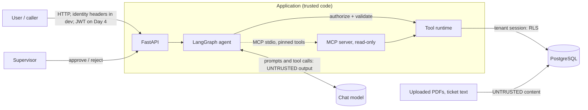

# Threat model and security roadmap

A small, practical threat model for an AI application: what could go wrong, which control
answers it, where the control lives and how it is tested. Kept next to the code and
updated with every milestone, like the ADRs.

## 1. Where this system sits

| Framework | Classification | What it implies |
| --- | --- | --- |
| [AWS Generative AI Security Scoping Matrix](https://aws.amazon.com/ai/generative-ai/security/scoping-matrix/) | **Scope 3, pre-trained models**: we call foundation models (Bedrock, Ollama) through an API, with our own data (RAG), no fine-tuning | We own the application, the data, identity, retrieval and the prompts; the provider owns the model. Threat modeling must cover prompt injection and data leakage. |
| [AWS Agentic AI Security Scoping Matrix](https://aws.amazon.com/ai/security/agentic-ai-scoping-matrix/) | **Scope 2, prescribed agency**: the agent reads freely but any change needs a human approval | Read-only tools; a write is only a *proposal* until a person approves it. Moving to Scope 3 (acting without per-action approval) would need behavioural monitoring and a kill switch first. |

Reference lists used for the threat table (IDs appear in the table below):

- [OWASP Top 10 for LLM Applications 2025](https://genai.owasp.org/llm-top-10/) (`LLM01`–`LLM10`)
- [OWASP Top 10 for Agentic Applications 2026](https://genai.owasp.org/) (`ASI01`–`ASI10`)
- [OWASP MCP Top 10](https://owasp.org/www-project-mcp-top-10/) (beta, `MCP01`–`MCP10`) and the
  [MCP security best practices](https://modelcontextprotocol.io/specification/2025-11-25/basic/security_best_practices)
- [MITRE ATLAS](https://atlas.mitre.org/) for attacker techniques; STRIDE for the classic part
- [AWS Well-Architected Generative AI Lens, security pillar](https://docs.aws.amazon.com/wellarchitected/latest/generative-ai-lens/security.html)

## 2. Assets

1. **Tenant data**: policies, orders, invoices, tickets, suppliers. One tenant must never
   see another tenant's data.
2. **Integrity of actions**: a return authorization is a commitment of money; it must only
   exist if an authorised person approved it.
3. **Audit trail**: who asked what, which tool ran, who approved.
4. **Model budget**: tokens are money on Bedrock ("denial of wallet").
5. **Credentials**: database password, AWS credentials (none stored in the repo).

## 3. Trust boundaries

Untrusted: the user's text, document contents, ticket subjects, **everything the model
outputs** (including tool calls) and anything an MCP server declares. Trusted: our code,
the database policies, the identity resolved by the API.

## 4. Threats and controls

Status: ✅ in place · 🟡 partial · ⏳ planned (day)

| # | Threat | Framework IDs | Control | Where | Status / test |
| --- | --- | --- | --- | --- | --- |
| T1 | One tenant reads another's documents or records (also via vector search) | LLM02, LLM08 | Tenant filter in every query **and** Row-Level Security that fails closed; per-tenant embedding cache | `app/database/tenancy.py`, RLS migration | ✅ `test_tenancy.py`, guard test for new tables |
| T2 | Direct prompt injection ("ignore your instructions…") | LLM01, ASI01 | System prompt boundaries; the model has no privileged tools to abuse; outputs validated in code | `app/rag/answer.py`, `app/agents/` | 🟡 basic; red-team set ⏳ Day 4 |
| T3 | Indirect prompt injection from a document or a ticket | LLM01, ASI01, ASI06 | Sources and tool results are delimited, JSON-encoded, size-capped and declared as data; an injected instruction can at most produce a *proposal* a human reviews | `app/rag/context.py`, `app/agents/graph.py` | ✅ ticket T-5009 scenario + test |
| T4 | The agent does more than it should (excessive agency) | LLM06, ASI02 | Read-only tools; one write action, executed only after approval (Scope 2) | `app/tools/catalog.py`, `app/agents/graph.py` | ✅ graph tests |
| T5 | A role uses a tool it should not (e.g. support agent reads invoices) | LLM06, ASI03 | Deny-by-default role × tool matrix, checked at execution; the model only sees allowed tools | `app/tools/authorization.py` | ✅ unit + integration tests |
| T6 | Confused deputy: the model passes another tenant or user as an argument | ASI03, MCP07 | Tenant, user and role come from the authenticated request (or the MCP launch config), never from tool arguments | `app/tools/runtime.py` | ✅ schemas have no tenant field |
| T7 | Self-approval or double execution of an action | ASI09 | Approver must hold `supervisor` and differ from the requester (checked in code **and** a DB CHECK); atomic claim of the pending approval; one RMA per order | `app/agents/service.py`, migration | ✅ API tests |
| T8 | The human approves based on a misleading model summary | ASI09 | The approval request shows facts read from the database (order, dates, lines), not the model's words | `app/tools/actions.py` | ✅ |
| T9 | Malformed or malicious tool arguments (SQL injection, huge inputs) | LLM05, MCP05 | Strict Pydantic schemas (patterns, lengths, `extra="forbid"`), parameterized SQL, row limits | `app/tools/` | ✅ unit tests |
| T10 | Runaway loops and token spend | LLM10, ASI08 | Max model steps, max tool calls per step, max output tokens, prompt budget | settings `AGENT_*`, `RAG_*` | ✅ step-limit test; per-tenant budget ⏳ Day 4 |
| T11 | Nobody can tell what the agent did | ASI10, STRIDE repudiation | Append-only audit log: the app role can INSERT and SELECT, not UPDATE or DELETE | `audit_events`, migration | ✅ test that UPDATE is refused |
| T12 | MCP tool poisoning or rug pull (a tool description changes after review) | MCP03, ASI04 | The client pins each tool (hash of name, description, schema) and refuses unknown or changed tools | `app/agents/mcp_client.py` | ✅ test with a tampered server |
| T13 | MCP server with broad privileges or token passthrough | MCP01, MCP02, MCP07 | stdio only (no network port), read-only tools, one principal fixed at launch, no tokens forwarded | `app/mcp_server/` | ✅ |
| T14 | Sensitive data in logs or in the model's context | LLM02, MCP01 | Logs never contain prompts, documents or tool outputs; tools return only the fields a task needs | `app/core/logging.py`, tools | 🟡 by convention; redaction review ⏳ Day 4 |
| T15 | Spoofed identity (anyone can send `X-Tenant-ID`) | STRIDE spoofing, API2 | Dev headers only accepted in `local`/`test`; Day 4: verified JWT (signature, issuer, audience, expiry) | `app/api/dependencies.py` | 🟡 ⏳ Day 4 |
| T16 | Vulnerable or tampered dependencies, leaked secrets in git | LLM03, ASI04 | Lockfile (`uv.lock`), signed commits; Day 4 CI: `pip-audit`, `gitleaks`, Trivy, SBOM, Dependabot, actions pinned by SHA | CI | 🟡 ⏳ Day 4 |
| T17 | Over-privileged cloud identity or public data | Cloud | Least-privilege IAM per service, encryption at rest, TLS only, no public buckets, VPC endpoints | Terraform | ⏳ Day 4 |
| T18 | Poisoned knowledge base (a malicious PDF uploaded as policy) | LLM04 | Uploads only by authenticated users of the tenant, size/type validation, version registry; Day 4: upload restricted to an `editor` role | `app/api/documents.py` | 🟡 |

Observed with the local model (Day 3): Qwen3 8B without thinking proposed a return
authorization for an order outside the policy window. The approval gate (T4, T8) stopped
it; a supervisor saw `days_since_delivery: 40` and rejected it. The same model reported and
ignored the injected instruction in ticket T-5009 (T3).

Residual risks, stated plainly:
- LangGraph checkpoint tables (conversation state) are not under RLS; access goes through
  the thread ownership check in `agent_threads`, which is.
- The local model can still be talked into a wrong *answer* (no write happens, but the
  text can be wrong). Faithfulness checks are Day 4.
- Development identity headers are spoofable by design until Day 4.
- Calls through MCP are audited with the server's identity but without the agent's thread
  id; correlation needs a run id in the MCP request metadata.

## 5. Security roadmap

Nothing extreme: each item is small, testable and maps to a real control a cloud security
or AI security interview asks about.

### Day 3 — agent and MCP (built)
- [x] Least agency: read-only tools + one approval-gated action (T4)
- [x] Role × tool authorization, deny by default, re-checked at execution (T5)
- [x] Identity from trusted context; separation of duties for approvals (T6, T7)
- [x] Strict tool schemas, parameterized SQL, row limits (T9)
- [x] Untrusted tool output handling + indirect injection scenario (T3)
- [x] Bounded loop (T10)
- [x] Append-only audit log (T11)
- [x] MCP: stdio, read-only, fixed principal; client-side tool pinning (T12, T13)

### Day 4 — application and supply chain
- [ ] JWT authentication (local JWKS in dev, Cognito-compatible); roles from claims (T15)
- [ ] Rate limits and a per-tenant daily token budget (T10)
- [ ] Safe error responses, security headers, upload restricted to an editor role (T18)
- [ ] AI red-team set (`make eval-security`): direct/indirect injection, system-prompt
      extraction, cross-tenant probing, tool abuse; attack success rate in the benchmark
- [ ] CI security: `pip-audit`, `gitleaks` (also over the full history before the repo goes
      public), Trivy image + IaC scan, SBOM, Dependabot, pinned actions, minimal
      `permissions:` (T16)
- [ ] Hardened container: non-root user, slim runtime, no dev tools (T16)

### Day 4 — cloud (Terraform, plan only until approved)
- [ ] IAM least privilege: one task role per service; `bedrock:InvokeModel` only on the two
      model ARNs; S3/SQS limited to the project resources; validated with IAM Access
      Analyzer `validate-policy` and Checkov/Trivy (T17)
- [ ] GitHub Actions → AWS through OIDC (no long-lived access keys)
- [ ] Data protection: encryption at rest (RDS, S3, SQS), TLS-only bucket policy, Block
      Public Access, credentials in SSM Parameter Store / Secrets Manager
- [ ] Network: private subnets, security groups by reference, VPC endpoints instead of NAT
- [ ] Detection: CloudTrail (management events), opt-in Bedrock invocation logging treated
      as sensitive data, cost and error alarms
- [ ] (S, paid) Bedrock Guardrails prompt-attack filter measured on the red-team set, only
      with approval

### How this maps to cloud security skills

| Skill area (AWS Security Specialty style) | Practised here |
| --- | --- |
| Identity and access management | Role × tool matrix, separation of duties, IAM task roles, OIDC |
| Data protection | RLS tenant isolation, encryption at rest, data minimisation |
| Infrastructure security | Private networking, VPC endpoints, hardened containers |
| Logging and monitoring | Append-only audit log, CloudTrail, alarms |
| Threat detection and incident response | Red-team set, audit queries, kill switch for the agent (`AGENT_ENABLED`) |
| Governance | Threat model, ADRs, scoping matrices, dependency and secret scanning |
