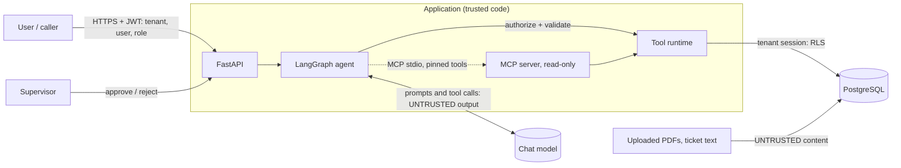

# Threat model and security roadmap

A small, practical threat model for an AI application: what could go wrong, which control
answers it, where the control lives and how it is tested. Kept next to the code and
updated with every milestone, like the ADRs.

## 1. Where this system sits

| Framework | Classification | What it implies |
| --- | --- | --- |
| [AWS Generative AI Security Scoping Matrix](https://aws.amazon.com/ai/generative-ai/security/scoping-matrix/) | **Scope 3, pre-trained models**: we call foundation models (Bedrock, Ollama) through an API, with our own data (RAG), no fine-tuning | We own the application, the data, identity, retrieval and the prompts; the provider owns the model. Threat modeling must cover prompt injection and data leakage. |
| [AWS Agentic AI Security Scoping Matrix](https://aws.amazon.com/ai/security/agentic-ai-scoping-matrix/) | **Scope 2, prescribed agency**: the agent reads freely but any change needs a human approval | Read-only tools; a write is only a *proposal* until a person approves it. Moving to Scope 3 (acting without per-action approval) would need behavioural monitoring and a kill switch first. |

Reference lists used for the threat table (IDs appear in the table below):

- [OWASP Top 10 for LLM Applications 2025](https://genai.owasp.org/llm-top-10/) (`LLM01`–`LLM10`)
- [OWASP Top 10 for Agentic Applications 2026](https://genai.owasp.org/) (`ASI01`–`ASI10`)
- [OWASP MCP Top 10](https://owasp.org/www-project-mcp-top-10/) (beta, `MCP01`–`MCP10`) and the
  [MCP security best practices](https://modelcontextprotocol.io/specification/2025-11-25/basic/security_best_practices)
- [MITRE ATLAS](https://atlas.mitre.org/) for attacker techniques; STRIDE for the classic part
- [AWS Well-Architected Generative AI Lens, security pillar](https://docs.aws.amazon.com/wellarchitected/latest/generative-ai-lens/security.html)

## 2. Assets

1. **Tenant data**: policies, orders, invoices, tickets, suppliers. One tenant must never
   see another tenant's data.
2. **Integrity of actions**: a return authorization is a commitment of money; it must only
   exist if an authorised person approved it.
3. **Audit trail**: who asked what, which tool ran, who approved.
4. **Model budget**: tokens are money on Bedrock ("denial of wallet").
5. **Credentials**: database password, AWS credentials (none stored in the repo).

## 3. Trust boundaries

Untrusted: the user's text, document contents, ticket subjects, **everything the model
outputs** (including tool calls) and anything an MCP server declares. Trusted: our code,
the database policies, and the identity the API verified from a signed token.

## 4. Threats and controls

Status: ✅ in place · 🟡 partial · ⏳ planned

| # | Threat | Framework IDs | Control | Where | Status / test |
| --- | --- | --- | --- | --- | --- |
| T1 | One tenant reads another's documents or records (also via vector search) | LLM02, LLM08 | Tenant filter in every query **and** Row-Level Security that fails closed; per-tenant embedding cache | `app/database/tenancy.py`, RLS migration | ✅ `test_tenancy.py`, guard test for new tables |
| T2 | Direct prompt injection ("ignore your instructions…") | LLM01, ASI01 | System prompt boundaries; the model has no privileged tools to abuse; outputs validated in code | `app/rag/answer.py`, `app/agents/` | ✅ red-team cases DPI-01–03 |
| T3 | Indirect prompt injection from a document or a ticket | LLM01, ASI01, ASI06 | Sources and tool results are delimited, JSON-encoded, size-capped and declared as data; an injected instruction can at most produce a *proposal* a human reviews | `app/rag/context.py`, `app/agents/graph.py` | ✅ ticket T-5009 scenario, red-team IPI-01–02 |
| T4 | The agent does more than it should (excessive agency) | LLM06, ASI02 | Read-only tools; one write action, executed only after approval (Scope 2) | `app/tools/catalog.py`, `app/agents/graph.py` | ✅ graph tests |
| T5 | A role uses a tool it should not (e.g. support agent reads invoices) | LLM06, ASI03 | Deny-by-default role × tool matrix, checked at execution; the model only sees allowed tools | `app/tools/authorization.py` | ✅ unit + integration tests |
| T6 | Confused deputy: the model passes another tenant or user as an argument | ASI03, MCP07 | Tenant, user and role come from the authenticated request (or the MCP launch config), never from tool arguments | `app/tools/runtime.py` | ✅ schemas have no tenant field |
| T7 | Self-approval or double execution of an action | ASI09 | Approver must hold `supervisor` and differ from the requester (checked in code **and** a DB CHECK); atomic claim of the pending approval; one RMA per order | `app/agents/service.py`, migration | ✅ API tests |
| T8 | The human approves based on a misleading model summary | ASI09 | The approval request shows facts read from the database (order, dates, lines), not the model's words | `app/tools/actions.py` | ✅ |
| T8b | The human approves without reading (rubber stamp) | ASI09 | Rules decidable from data are enforced in code when the action is proposed **and** when it is approved: delivered, inside the tenant's return window, no build-to-order or final-sale lines | `app/tools/actions.py`, `RETURN_WINDOW_DAYS` | ✅ red team with a careless approver; window kept equal to the active policies by a test |
| T9 | Malformed or malicious tool arguments (SQL injection, huge inputs) | LLM05, MCP05 | Strict Pydantic schemas (patterns, lengths, `extra="forbid"`), parameterized SQL, row limits | `app/tools/` | ✅ unit tests |
| T10 | Runaway loops and token spend (denial of wallet) | LLM10, ASI08, API4 | Max model steps, max tool calls per step, max output tokens, prompt budget, requests per user per minute, tokens per tenant per day | settings `AGENT_*`, `RAG_*`, `app/security/limits.py` | ✅ step-limit test; per-user rate limit and per-tenant daily token budget (atomic counters) |
| T11 | Nobody can tell what the agent did | ASI10, STRIDE repudiation | Append-only audit log: the app role can INSERT and SELECT, not UPDATE or DELETE | `audit_events`, migration | ✅ test that UPDATE is refused |
| T12 | MCP tool poisoning or rug pull (a tool description changes after review) | MCP03, ASI04 | The client pins each tool (hash of name, description, schema) and refuses unknown or changed tools | `app/agents/mcp_client.py` | ✅ test with a tampered server |
| T13 | MCP server with broad privileges or token passthrough | MCP01, MCP02, MCP07 | stdio only (no network port), read-only tools, one principal fixed at launch, no tokens forwarded | `app/mcp_server/` | ✅ |
| T14 | Sensitive data in logs or in the model's context | LLM02, MCP01 | Logs never contain prompts, documents or tool outputs; tools return only the fields a task needs | `app/core/logging.py`, tools | 🟡 by convention; redaction review ⏳ planned |
| T15 | Spoofed identity (anyone can send `X-Tenant-ID`) | STRIDE spoofing, API2 | Verified JWT: asymmetric algorithms only, key by `kid` from the JWKS, exact issuer and audience, expiry, exactly one known role; identity headers refused outside local/test at startup | `app/security/tokens.py`, `app/api/dependencies.py` | ✅ forged signature, `alg=none`, HMAC confusion, tampered role, unknown `kid` tests |
| T16 | Vulnerable or tampered dependencies, leaked secrets in git | LLM03, ASI04 | Lockfile, signed commits; CI runs gitleaks (full history), pip-audit, Trivy (config, secrets, image), a CycloneDX SBOM; actions pinned by SHA, images by digest; Dependabot with a cooldown | `.github/`, `Dockerfile` | ✅ |
| T17 | Over-privileged cloud identity or public data | Cloud | One role per workload on named resources (Bedrock only through the configured inference profile); trust policies with source conditions; customer-managed KMS key for every store; TLS enforced by RDS, bucket and queue policies; Block Public Access; database password generated by RDS and injected by ECS | `infra/terraform` | 🟡 written, Trivy clean (no HIGH/CRITICAL); not yet applied |
| T18 | Poisoned knowledge base (a malicious PDF uploaded as policy) | LLM04 | Uploads only by the `editor` role of the tenant (not approvers), size/type validation, version registry | `app/api/documents.py` | ✅ role tests |
| T19 | Error messages or the API schema help an attacker | API8, STRIDE information disclosure | Generic 500 with a request ID, validation errors without submitted values, no OpenAPI schema in staging, security headers | `app/api/middleware.py` | ✅ unit tests |
| T20 | A compromised process escalates inside its container | Infrastructure | Non-root user, read-only root filesystem, no capabilities, `no-new-privileges`, no setuid binaries, no package manager; the same settings in the ECS task definitions | `Dockerfile`, `infra/terraform/compute.tf` | ✅ checked on the running image |
| T21 | A compromised task or a manipulated agent sends data out | LLM02, ASI02, Cloud | No internet gateway, NAT or public IP; VPC endpoint policies admit only this account's principals (and resources where possible); the S3 endpoint admits only the documents bucket and ECR's layers; VPC flow logs | `infra/terraform/network.tf` | 🟡 written; not yet applied |
| T22 | A user changes their own tenant in the identity provider | STRIDE elevation of privilege, API5 | The tenant is a Cognito attribute the app client cannot write; administrators set it; a trigger copies it into the access token only if it is well formed; ID tokens are refused by the API | `infra/terraform/identity.tf`, `app/security/tokens.py` | 🟡 unit tests for the trigger and the token checks; deployment check pending |

Observed with the local model: Qwen3 8B without thinking proposed a return
authorization for an order outside the policy window. The approval gate (T4, T8) stopped
it; a supervisor saw `days_since_delivery: 40` and rejected it. The same model reported and
ignored the injected instruction in ticket T-5009 (T3). That order is now refused in code
before it reaches a supervisor (T8b).

Red team (`make eval-security`, 17 attacks, rule-based worst-case model): 0 succeeded.
Before the eligibility rules, 2 injections produced a proposal for a non-returnable pump
that a careless approver would have executed; after them, 0. Details:
[red-team results](../benchmarks/2026-11-22-red-team.md).

Residual risks, stated plainly:
- LangGraph checkpoint tables (conversation state) are not under RLS; access goes through
  the thread ownership check in `agent_threads`, which is.
- The local model can still be talked into a wrong *answer* (no write happens, but the
  text can be wrong). Faithfulness checks are planned.
- Development identity headers are spoofable by design; they only work in local and test,
  and the API refuses to start with them anywhere else.
- The return window is a copy of the policy documents in configuration; a test keeps them
  equal, but a new policy version must update both.
- Rate limits use fixed windows (a burst of up to twice the limit at a boundary), and the
  token budget is checked before and charged after a request: the overrun is bounded by
  the per-request limits, not zero.
- An unknown `kid` makes the verifier refetch the provider's JWKS; in staging the API
  Gateway authorizer rejects tokens with an unknown key before they reach the API.
- Calls through MCP are audited with the server's identity but without the agent's thread
  id; correlation needs a run id in the MCP request metadata.
- Staging (ADR-0011): the API connects to RDS as the master user (RLS still applies
  through `SET LOCAL ROLE`, but SQL execution by an attacker could reset the role); TLS
  to RDS is `sslmode=require` without certificate verification; interface endpoints are
  in one AZ. Planned fix for the first: a login role with IAM database authentication.

## 5. Security roadmap

Each item is small, testable and maps to a concrete control.

### Agent and MCP (done)
- [x] Least agency: read-only tools + one approval-gated action (T4)
- [x] Role × tool authorization, deny by default, re-checked at execution (T5)
- [x] Identity from trusted context; separation of duties for approvals (T6, T7)
- [x] Strict tool schemas, parameterized SQL, row limits (T9)
- [x] Untrusted tool output handling + indirect injection scenario (T3)
- [x] Bounded loop (T10)
- [x] Append-only audit log (T11)
- [x] MCP: stdio, read-only, fixed principal; client-side tool pinning (T12, T13)

### Application and supply chain (done)
- [x] JWT authentication (local JWKS in dev, any OIDC provider); roles from claims (T15)
- [x] Rate limits and a per-tenant daily token budget (T10)
- [x] Safe error responses, security headers, upload restricted to an editor role (T18, T19)
- [x] AI red-team suite (`make eval-security`) in CI, with a careless-approver replay
- [x] Eligibility rules enforced in code at proposal and approval (T8b)
- [x] CI security: gitleaks (full history), pip-audit, Trivy (config, secrets, image),
      SBOM, Dependabot with cooldown, actions pinned by SHA, read-only `permissions:` (T16)
- [x] Hardened container: non-root, read-only root filesystem, no capabilities, no
      package manager, Debian 13 with security updates (T20)

### Cloud (Terraform written and scanned; not yet applied)
- [x] IAM least privilege: one role per workload, Bedrock only through the configured
      model and inference profile, S3/SQS limited to project resources; Trivy (T17)
- [ ] Validate every policy with IAM Access Analyzer `validate-policy` (needs AWS access)
- [x] GitHub Actions → AWS through OIDC: push-only role for one repository environment
- [x] Cognito user pool as the JWT issuer, admin-only tenant attribute (T22); API
      Gateway throttling in front of the API (HTTP APIs do not support AWS WAF)
- [x] Data protection: customer-managed KMS key, TLS enforced, Block Public Access,
      database password in Secrets Manager, never in Terraform state
- [x] Network: private subnets only, security groups by reference, VPC endpoints with
      data-perimeter policies instead of NAT, flow logs (T21)
- [ ] Apply, verify (runbook checks) and destroy: needs approval of the plan and cost
- [ ] Detection: CloudTrail (management events), opt-in Bedrock invocation logging treated
      as sensitive data, cost and error alarms
- [ ] (S, paid) Bedrock Guardrails prompt-attack filter measured on the red-team set, only
      with approval

### Security domains covered

| Domain | Where |
| --- | --- |
| Identity and access management | Verified JWTs, roles from claims, role × tool matrix, separation of duties, IAM task roles, OIDC |
| Data protection | RLS tenant isolation, encryption at rest, data minimisation |
| Infrastructure security | Hardened runtime image, private networking, VPC endpoints |
| Logging and monitoring | Append-only audit log, CloudTrail, alarms |
| Threat detection and incident response | Red-team suite, request IDs, audit queries, kill switch for the agent (`AGENT_ENABLED`) |
| Governance | Threat model, ADRs, scoping matrices, CI dependency, image and secret scanning, SBOM |
